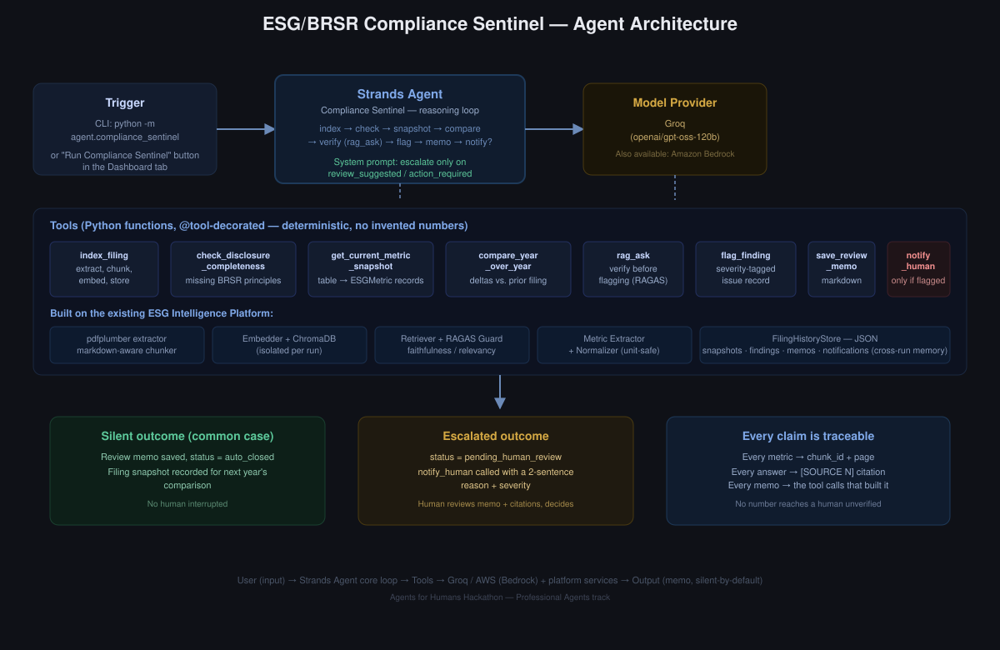

# ESG / BRSR Report Intelligence Platform

Live Demo: https://ntini97-esg-brsr-intelligence.hf.space/

## Project layout

```text
├── agent/
│   ├── compliance_sentinel.py     # Main agent execution workflow
│   ├── history_store.py           # Thread-safe in-memory/disk session history
│   ├── model_provider.py          # Strands Model builder configuration
│   └── tools.py                  # Sentinel agent tool definitions
├── config/
│   └── settings.py               # Central dataclass configuration & env vars
├── src/
│   ├── embedding/
│   │   ├── embedder.py           # Local SentenceTransformer & ChromaDB EphemeralClient
│   │   └── indexer.py            # Document loading, chunking, and embedding pipeline
│   ├── evaluation/
│   │   └── ragas_guard.py        # Faithfulness, context, and answer relevancy metrics
│   ├── metrics/
│   │   ├── extractor.py          # Deterministic key-value table metric parser
│   │   ├── normalizer.py         # Metric name canonicalization & unit compatibility
│   │   └── schema.py             # Structured ESGMetric dataclass
│   ├── preprocessing/
│   │   └── preprocessor.py       # Docling layout-aware PDF parser
│   ├── rag/
│   │   └── rag_pipeline.py       # RAG pipeline with citation normalization
│   ├── retrieval/
│   │   └── retriever.py          # BM25 + Cross-Encoder hybrid retriever
│   └── visualization/
│       ├── chart_generator.py    # Intent detection & Plotly chart builder
│       └── dashboard.py          # Streamlit analytics dashboard renderer
├── app.py                        # Streamlit web application entrypoint
├── requirements.txt              # Production dependencies
└── README.md
```

## Running locally

### Local Setup

Copy .env.example to .env and provide your Groq API key:

```bash
cp .env.example .env   # then fill in GROQ_API_KEY
pip install -r requirements.txt
```

### CLI

To run the Compliance Sentinel directly from the terminal:

```bash
python -m agent.compliance_sentinel --file report.pdf --company "ABCD Corp" --year FY2024-25
```

### GUI

Launch the Streamlit web interface:

```bash
streamlit run app.py
```

## Compliance Sentinel Agent (Agents for Humans hackathon)

`agent/` adds an autonomous Strands Agents SDK
agent that reviews a newly filed report end-to-end — indexes it, checks for
missing BRSR disclosures, compares against the company's last filing,
verifies anything ambiguous before concluding, writes a cited memo, and
**only notifies a human when something actually needs attention**. 

## Architecture


## Known limitations

- **Metric extraction is heuristic.** It only converts a table cell into an
  `ESGMetric` when the row label and cell both parse unambiguously.
- **Company / reporting year are user-supplied at upload**, not
  auto-detected from document content. 
- **Charts refuse to combine incompatible units** rather than doing a
  unit conversion — cross-report unit conventions vary enough (e.g. tCO2e
  vs. tCO2, KL vs. m³) that silent conversion is a bigger accuracy risk than
  a clear refusal message.